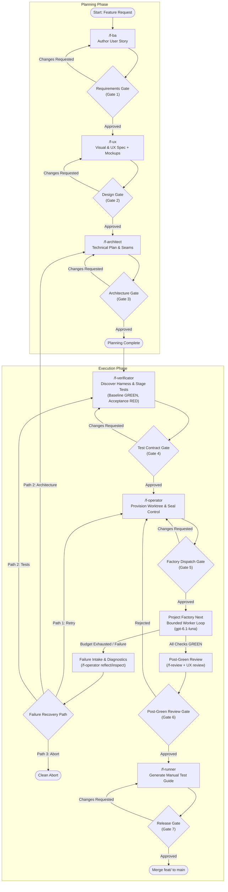

# SDLC Domain Architecture and Operational Workflow Guide

This document is the authoritative operational manual and domain architecture guide for developing software features within **Empire English CRM (EE-CRM)** using **Project Factory Next**. It defines the roles, contracts, directory topologies, state transitions, named human gates, operational commands, and failure recovery paths.

---

## 1. Architectural Principles & Isolation Model

Automated feature development with coding agents introduces distinct failure modes: agents rewriting their own tests to force green builds, scope drift across combined prompts, and polluted workspaces. The Factory SDLC solves this through three core architectural tenets:

1. **Role Specialization**: Every stage is executed by a dedicated agent role (`f-*`) tuned to a specific reasoning profile.
2. **Immutable Test Sealing**: Verification tests are authored independently by QA (`/f-verificator`) and sealed into an external control bundle before the coding worker ever starts. The worker agent has zero write access to the test suite.
3. **Tri-Directory Physical Isolation Inside the Workspace**: Project Factory Next enforces the invariant `assertSeparate(candidate, control, store)` where all three directories must be separate and non-nested. To keep all operations cleanly contained within the project repository near the target application `ee-crm/`, all three factory directories reside under `.sdlc/` (git-ignored):

The following topology is authoritative for storage locations. Control versions remain separate from the candidate and shared store.

```
poc-zom-report/                         ← Main Repository (Trunk & Target Project)
├── ee-crm/                             ← Active application codebase being modified
├── docs/                               ← Permanent documentation & specifications
│   ├── stories/<story-id>.md           ← Requirements & Acceptance Criteria
│   ├── architecture/                   ← Architecture Plans & ADRs
│   └── ux/                             ← Visual & UX Specifications
└── .sdlc/                              ← Ephemeral SDLC & Factory Workspaces (git-ignored)
    ├── store/                          ← 3. Factory Runs Store (execution logs, attempts, evidence)
    └── <story-id>/
        ├── candidate/                  ← 1. Candidate Worktree (isolated git worktree: feat/<story-id>)
        ├── control/
        │   ├── v1/                     ← 2. Initial Control Bundle (task.json, profile.json, evaluators/, seal.json)
        │   └── v2/                     ← Next approved control version; v1 remains unchanged
        ├── diagnostics/                ← Versioned failure intake reports
        ├── mockups/                    ← Interactive HTML mockups (from /f-ux)
        ├── tests/                      ← Staged acceptance tests (from /f-verificator)
        ├── state.json                  ← Authoritative state ledger
        ├── review-report.md            ← Post-green review report
        └── manual-test-guide.md        ← Step-by-step manual test guide
```

---

## 2. Shared Domain Architecture & Contracts

The authoritative definitions and canonical vocabulary for the SDLC domain are maintained in the root [**`GLOSSARY.md`**](../../GLOSSARY.md). The architectural contracts and structural roles for each element are formalized below:

### Physical Isolation Rules

Use the [authoritative topology](#1-architectural-principles--isolation-model) for directory locations. The candidate is a complete Git worktree branched from `main` on `feat/<story-id>`. The worker edits only this checkout; operator-controlled permissions protect each sealed control version. The shared store persists across stories and survives story cleanup.

### Contracts & Cryptographic Sealing
- **Task Contract** (`<control-dir>/task.json`): Schema-validated (Schema v1) specification detailing task requirements, preparation steps, evaluator check IDs, and execution budget (`maxAttempts`, `agentTimeoutMs`).
- **Dev Profile** (`<control-dir>/profile.json`): Task family definition (`software-change`, `website-clone`, `design-implementation`) specifying mandatory check kinds and default budgets.
- **Policy Digest** (`policyDigest`): Lowercase 64-character SHA-256 hash computed via `node bin/factory.mjs seal --control <dir>`. Verifies control bundle immutability; rejected by runner if tampered.
- **Evaluator** (`<control-dir>/evaluators/`): Sealed test scripts reporting aggregate pass/fail results via JSON (`{ status: "passed"|"failed", cases: [{ id, status, details }] }`).

---

## 3. End-to-End Operational Lifecycle & State Transitions

This diagram is the authoritative transition definition. Gate criteria are defined in [section 4](#4-the-seven-named-human-gates-protocol), and recovery procedures in [section 8](#8-failure-handling--recovery-paths). Planning ends at `S_PLAN_DONE`; execution starts with `/f-verificator`. An abort from any active stage follows Path 3.



---

## 4. The Seven Named Human Gates Protocol

Human supervision is enforced at every role transition through named, first-class gates. Execution halts automatically and waits for explicit user sign-off.

| Gate | Name | Gate ID | Preceding Role | Primary Artifacts | Approval Criteria |
|---|---|---|---|---|---|
| **Gate 1** | **Requirements Gate** | `gate-requirements` | `/f-ba` | `docs/stories/<story-id>.md` | Scope is clear; criteria include before/after expectations, preserved core journeys, and explicit authorization for changed or removed behavior; invariants and edge cases are stated. |
| **Gate 2** | **Design Gate** | `gate-design` | `/f-ux` | `docs/ux/<story-id>-ux.md`, `.sdlc/<story-id>/mockups/*.html` | Two minimal interactive storyboard alternatives render cleanly; the human selects one; hierarchy, responsive behavior, accessibility, and WCAG 2.2 AA contrast are verified. Journey and state changes trace to approved requirements. Technical stories document justified N/A UX. |
| **Gate 3** | **Architecture Gate** | `gate-architecture` | `/f-architect` | `docs/architecture/<story-id>-plan.md` | A visual decision card explains the change with before/after C4 views and relevant request flows; module boundaries conform to ADR-001; vertical slice seams are sound; data contracts and schema updates are complete; non-goals are explicit; affected capabilities, dependencies, testing seams, and existing suites are proposed. |
| **Gate 4** | **Test Contract Gate** | `gate-test-contract` | `/f-verificator` | `.sdlc/<story-id>/test-impact.md`, staged tests and exact QA changes, Verificator execution report | The [test impact contract](test-impact-contract.md) defines case-level Preserve/Add/Replace/Retire decisions. Baseline expectations pass GREEN; Add/Replace assertions demonstrate expected RED. Approval covers the impact plan, staged manifest, and exact replacements/removals. |
| **Gate 5** | **Factory Dispatch Gate** | `gate-factory-dispatch` | `/f-operator` | `<control-dir>/task.json`, computed `policyDigest`, profile | `policyDigest` is verified; task requirements and check IDs match; worker model (`gpt-6.1-luna`) and `maxAttempts` budget are confirmed; candidate worktree is provisioned; its base revision, approved QA-owned test changes, current diff, and any retained retry changes are inspected. |
| **Gate 6** | **Post-Green Review Gate** | `gate-review` | `/f-review` + UX review | `.sdlc/<story-id>/review-report.md`, candidate git diff | Code quality matches architectural invariants; UI implementation aligns with UX tokens; all approved active cases pass; candidate test changes match approved QA changes; no tests or evaluators were bypassed. |
| **Gate 7** | **Release Gate** | `gate-release` | `/f-runner` | `.sdlc/<story-id>/manual-test-guide.md` | Human tester successfully executed step-by-step manual test guide against live candidate; user approves merging branch to main. |

### Gate Interaction Protocol

1. **Gate Presentation**: When reaching a gate, the orchestrator halts execution and displays:
   - Current Story ID, Gate Number, and **Gate Name** (e.g., `Gate 4: Test Contract Gate`).
   - Clickable links to all generated artifacts.
   - Summary of decisions made and verification outcomes.
   - Specific questions or checkpoints requiring human validation.
2. **Acceptance (`approve [gate-name]`)**: Record sign-off in the state ledger and follow the approved edge in the [transition definition](#3-end-to-end-operational-lifecycle--state-transitions).
3. **Revision (`revise [gate-name] --notes "<feedback>"`)**: Re-invoke the preceding role with feedback constraints. Invalidate its approval and all downstream approvals when its artifact changes; retain prior sign-offs in history. Role revisions dispatched by the orchestrator follow the same rule. Any new control version requires renewed Factory Dispatch Gate approval of its path, digest, model, and per-run budget.
4. **Abort (`abort`)**: Pipeline execution terminates cleanly; transient worktrees and resources are pruned.

---

## 5. Role Specifications & Reasoning Matrix

| Role | Skill Command | Reasoning Level | Primary Responsibilities | Output Artifact |
|---|---|---|---|---|
| **Orchestrator** | `/f-orchestrator` | `medium` | Pipeline coordinator, phase state transitions, human gate enforcement, resumption management. | `.sdlc/<story-id>/state.json` |
| **Business Analyst** | `/f-ba` | `low` | Formalizing user stories, user personas, acceptance criteria, business invariants. | `docs/stories/<story-id>.md` |
| **UX Designer** | `/f-ux` | `medium` | Minimal task-focused design, two interactive storyboard alternatives, design tokens, responsive states. | `docs/ux/<story-id>-ux.md`, `.sdlc/<story-id>/mockups/` |
| **System Architect** | `/f-architect` | `high` | Technical plan, module seams, contracts, migrations, and a visual decision card. | `docs/architecture/<story-id>-plan.md`, `<story-id>-decision.html`, and linked SVG |
| **Implementation Reviewer** | `/f-review` | `high` | Independent implementation assessment for joint Gate 6 review. | Implementation assessment in `.sdlc/<story-id>/review-report.md` |
| **QA Verificator** | `/f-verificator` | `high` | Harness discovery, baseline regression testing (GREEN), acceptance test authoring staged in `.sdlc/<story-id>/tests/` (RED). | Staged test suites, test verification logs |
| **Factory Operator** | `/f-operator` | `medium` | Candidate worktree setup, control bundle creation, contract sealing, factory execution, failure intake. | `.sdlc/<story-id>/`, `policyDigest` |
| **Factory Worker** | (Internal to Factory) | `medium` (`gpt-6.1-luna`) | Autonomous, bounded code implementation inside candidate worktree, guided by compiler/evaluator feedback. | Candidate git commits |
| **Quality Runner** | `/f-runner` | `medium` | End-to-end manual verification guide, startup scripts, test seed credentials, step-by-step clickthrough paths. | `.sdlc/<story-id>/manual-test-guide.md` |
| **Advisor** | `/f-advisor` | `high` | Historical run analysis from `.sdlc/store/`, bottleneck diagnosis, profile and prompt tuning. | Advisor reports, custom flow templates |

---

## 6. Operational Command Reference

### Orchestrated Workflows

```bash
# Execute planning according to section 3
/f-orchestrator plan CRM-018

# Execute the approved plan according to section 3
/f-orchestrator execute CRM-018

# Inspect current pipeline status, active role, and pending gate
/f-orchestrator status CRM-018

# Resume an existing story from its recorded state ledger
/f-orchestrator resume CRM-018

# Terminate pipeline and clean up ephemeral worktrees
/f-orchestrator abort CRM-018
```

### Human Gate Decision Commands

When the orchestrator pauses at any of the named gates, decisions can be submitted via:

```bash
# Approve current gate (by name or default current) and advance
/f-orchestrator approve CRM-018 requirements
/f-orchestrator approve CRM-018 design
/f-orchestrator approve CRM-018 architecture
/f-orchestrator approve CRM-018 test-contract
/f-orchestrator approve CRM-018 factory-dispatch
/f-orchestrator approve CRM-018 review
/f-orchestrator approve CRM-018 release

# Request revisions from preceding role with feedback constraints
/f-orchestrator revise CRM-018 requirements --notes "Clarify conflict resolution rules in acceptance criteria"

# Abort active feature pipeline and prune ephemeral worktrees
/f-orchestrator abort CRM-018
```

> **Interactive Terminal/Chat Protocol**: When running in an interactive session, `/f-orchestrator` prompts directly after each role with artifact links and a multiple-choice prompt (`[1] Approve and proceed`, `[2] Request revisions`, `[3] Abort`). The commands above provide scriptable and explicit command-line counterparts.

### Internal Role Dispatch

`f-ba`, `f-ux`, `f-architect` (planning), and `f-review` (post-green) are orchestration-only skills. The human uses `f-orchestrator plan`, `execute`, or `revise`; the orchestrator dispatches the role with story ID, artifact/approval evidence, and human feedback for revisions. Role outputs return to the orchestrator for gate presentation and ledger updates. Each role owns its procedure in its skill. The orchestrator alone reads [the orchestration protocol](orchestration-protocol.md). Each role reads the resolved ASD-STE100 skill. Each role uses Strict mode for procedures and handoffs. Each role uses STE-flavored mode for human explanations. Caller restriction is a workflow instruction, not an access-control feature of skill metadata. Architect research and contra-review are outside this workflow.

The orchestrator skill remains scheduled in ticket 07; these are its dispatch contracts, not a claim that the complete pipeline is executable today. Ticket 06 still owns joint UX review, runner, and Gates 6–7 integration.

### Other Stage Commands

```bash
# Test discovery and verification only
/f-verificator CRM-018

# Factory operations (provision, seal, run, inspect, recover)
/f-operator CRM-018 --action provision
/f-operator CRM-018 --action seal
/f-operator CRM-018 --action run
/f-operator CRM-018 --action inspect --run-id <run-id>
/f-operator CRM-018 --action recover --run-id <run-id>

# Manual test guide generation only
/f-runner CRM-018

# Diagnostic analysis of historical factory runs
/f-advisor analyze --store .sdlc/store
```

### Underlying Project Factory Next CLI Reference

The Factory Operator interacts directly with the Factory Next kernel. Complete flag descriptions and schemas are documented in the [Factory Next Reference Manual](../../../project-factory-next/docs/handbook/reference.md). The canonical invocations used within this SDLC are:

```bash
# 1. Initialize control bundle inside a new control version
node /home/user/2grow/project-factory-next/bin/factory.mjs init \
  --out /home/user/2grow/poc-zom-report/.sdlc/<story-id>/control/v1 \
  --profile software-change

# 2. Validate control contracts and schema integrity
node /home/user/2grow/project-factory-next/bin/factory.mjs validate \
  --control /home/user/2grow/poc-zom-report/.sdlc/<story-id>/control/v1

# 3. Seal the control bundle and capture policyDigest
node /home/user/2grow/project-factory-next/bin/factory.mjs seal \
  --control /home/user/2grow/poc-zom-report/.sdlc/<story-id>/control/v1

# 4. Verify control bundle against known policyDigest
node /home/user/2grow/project-factory-next/bin/factory.mjs verify \
  --control /home/user/2grow/poc-zom-report/.sdlc/<story-id>/control/v1 \
  --policy-digest <policy-digest>

# 5. Execute factory run with candidate, control, and store co-located under .sdlc
node /home/user/2grow/project-factory-next/bin/factory.mjs run \
  --control /home/user/2grow/poc-zom-report/.sdlc/<story-id>/control/v1 \
  --candidate /home/user/2grow/poc-zom-report/.sdlc/<story-id>/candidate \
  --store /home/user/2grow/poc-zom-report/.sdlc/store \
  --policy-digest <policy-digest> \
  --agent codex \
  --model gpt-6.1-luna \
  --run-id <new-run-id>

# 6. Inspect evidence of a completed run
node /home/user/2grow/project-factory-next/bin/factory.mjs inspect \
  --store /home/user/2grow/poc-zom-report/.sdlc/store \
  --run-id <run-id>

# 7. Aggregate failure intake; choose a fresh output name on every invocation
node /home/user/2grow/project-factory-next/bin/factory.mjs reflect \
  --store /home/user/2grow/poc-zom-report/.sdlc/store \
  --out /home/user/2grow/poc-zom-report/.sdlc/<story-id>/diagnostics/<run-id>-intake-001.json

# 8. Remove stale controller locks following process interruption
node /home/user/2grow/project-factory-next/bin/factory.mjs recover \
  --store /home/user/2grow/poc-zom-report/.sdlc/store \
  --run-id <run-id>
```

---

## 7. State Ledger Record (`.sdlc/<story-id>/state.json`)

Pipeline execution state is tracked deterministically in a JSON ledger located at `.sdlc/<story-id>/state.json`.

```json
{
  "storyId": "CRM-018",
  "status": "IN_PROGRESS",
  "phase": "EXECUTION",
  "currentRole": "f-operator",
  "gateState": {
    "requirements": { "name": "Requirements Gate", "status": "APPROVED", "timestamp": "2026-10-06T10:00:00Z", "signedBy": "user" },
    "design": { "name": "Design Gate", "status": "APPROVED", "timestamp": "2026-10-06T10:15:00Z", "signedBy": "user" },
    "architecture": { "name": "Architecture Gate", "status": "APPROVED", "timestamp": "2026-10-06T10:30:00Z", "signedBy": "user" },
    "testContract": { "name": "Test Contract Gate", "status": "APPROVED", "timestamp": "2026-10-06T10:45:00Z", "signedBy": "user" },
    "factoryDispatch": { "name": "Factory Dispatch Gate", "status": "PENDING", "timestamp": null, "signedBy": null },
    "review": { "name": "Post-Green Review Gate", "status": "NOT_STARTED", "timestamp": null, "signedBy": null },
    "release": { "name": "Release Gate", "status": "NOT_STARTED", "timestamp": null, "signedBy": null }
  },
  "artifacts": {
    "storyPath": "docs/stories/CRM-018.md",
    "uxPath": "docs/ux/CRM-018-ux.md",
    "mockupsDir": ".sdlc/CRM-018/mockups/",
    "architecturePlanPath": "docs/architecture/CRM-018-plan.md",
    "testsDir": ".sdlc/CRM-018/tests/",
    "candidateDir": ".sdlc/CRM-018/candidate/",
    "controlDir": ".sdlc/CRM-018/control/v1/",
    "storeDir": ".sdlc/store/",
    "policyDigest": "a3f4c8b0a3f4c8b0a3f4c8b0a3f4c8b0a3f4c8b0a3f4c8b0a3f4c8b0a3f4c8b0",
    "reviewReportPath": ".sdlc/CRM-018/review-report.md",
    "manualTestGuidePath": ".sdlc/CRM-018/manual-test-guide.md",
    "failureIntakePath": null
  },
  "factory": {
    "runId": "run-crm-018-001",
    "attemptCount": 0,
    "maxAttempts": 3,
    "lastExitCode": null,
    "lastOutcome": null
  },
  "history": [
    { "phase": "PLANNING", "role": "f-ba", "status": "COMPLETED", "timestamp": "2026-10-06T10:00:00Z" }
  ]
}
```

The ledger is an instance record, not a JSON Schema. `status` is `IN_PROGRESS`, `COMPLETED`, or `ABORTED`; a failed factory run leaves the pipeline `IN_PROGRESS` awaiting a recovery decision. `phase`, `currentRole`, and gate states follow the [transition definition](#3-end-to-end-operational-lifecycle--state-transitions). Append each approval, revision, control version change, run outcome, and abort to `history`; retain prior run IDs and digests when updating the active entries.

---

## 8. Failure Handling & Recovery Paths

On a failed or exhausted run, stop dispatch and run `inspect` and `reflect` using the [CLI reference](#underlying-project-factory-next-cli-reference). Each reflection output uses a fresh diagnostics filename containing the failed run ID and an intake sequence; increment the sequence for repeated diagnosis of the same run. Record that path in `artifacts.failureIntakePath`. Present the evidence and the three recovery choices from the transition definition to the user.

### Preparing a New Control Version

Every recovery that changes a contract, budget, or evaluator uses a new control version. Version names are monotonically increasing within a story (`v1`, `v2`, and so on). Preserve the prior sealed bundle and its digest for evidence inspection. For example, to prepare `v2` from approved `v1`:

```bash
CONTROL_DIR=/home/user/2grow/poc-zom-report/.sdlc/CRM-018/control/v1
NEXT_CONTROL_DIR=/home/user/2grow/poc-zom-report/.sdlc/CRM-018/control/v2
# Refuse to overwrite a version that already exists.
if [ -e "$NEXT_CONTROL_DIR" ]; then
  echo "Choose a new control version" >&2
else
  cp -a "$CONTROL_DIR" "$NEXT_CONTROL_DIR" && rm "$NEXT_CONTROL_DIR/seal.json"
fi
```

Proceed only after a fresh copy succeeds and its copied seal has been removed. Edit only the new version, then run `validate` and `seal` against its path. Factory creates `seal.json` and refuses to seal an already sealed directory. Record the new `controlDir` and `policyDigest` in the ledger, invalidate downstream approvals under section 4, and present the new version at the Factory Dispatch Gate. After approval, use the canonical `run` invocation with the new control path and digest and a fresh run ID. A completed or failed run ID returns its old results and cannot be used for a new policy version.

### Path 1: Retry with Increased Attempt Budget

Use when diagnostic evidence shows progress and the user chooses another bounded run. Follow [Preparing a New Control Version](#preparing-a-new-control-version), increasing `budget.maxAttempts` in the new version’s `task.json` (for example, from 3 to 5), within the Factory schema’s 1–10 limit. The budget applies to the new run, whose attempt counter starts from zero; it is not an extension of the failed run’s counter. Retain the candidate changes and disclose the full new-run budget at the Factory Dispatch Gate.

### Path 2: Escalation to Architect or Verificator

Use when evidence points to infeasible architecture, incompatible contracts, or an erroneous acceptance assertion.

- **Architect**: Revise the architecture plan and return through the Architecture Gate. Re-run the verificator against the revised plan and obtain Test Contract Gate approval before packaging the corrected task context.
- **Verificator**: Correct staged tests and demonstrate baseline GREEN and acceptance RED for the expected reasons against the pre-implementation baseline. Return through the Test Contract Gate. The operator packages these tests into the new control version; prior sealed evaluators remain unchanged.

Both routes then follow [Preparing a New Control Version](#preparing-a-new-control-version) and renewed dispatch approval.

### Path 3: Clean Abort

Use when the user rejects or abandons the feature.

1. Stop the controller and worker processes and confirm they have exited before removing their candidate.
2. Mark the state ledger `ABORTED` and append the user’s decision, timestamp, run IDs, control digests, and cleanup intent to its history.
3. Archive any candidate changes needed for recovery, then remove the story’s worktree and branch. The following commands intentionally discard remaining candidate changes after archival:
   ```bash
   git worktree remove --force /home/user/2grow/poc-zom-report/.sdlc/<story-id>/candidate/
   git branch -D feat/<story-id>
   ```
4. Delete temporary mockups and staged tests as appropriate. Preserve the story directory with its terminal `state.json`, diagnostics, and sealed control versions, and retain the shared store so historical runs remain inspectable. Record cleanup completion or any error in the retained ledger.

### Operational Infrastructure Recovery: Dead-Worker Lock Removal

Separate from the three feature failure paths above, if a running controller process is abruptly terminated, the run directory may retain its controller PID lock.
1. Confirm the controller and its worker process tree are dead.
2. Recover the run lock:
   ```bash
   node /home/user/2grow/project-factory-next/bin/factory.mjs recover \
     --store /home/user/2grow/poc-zom-report/.sdlc/store \
     --run-id <original-run-id>
   ```
3. Re-invoke the original run command with identical parameters and run ID. Execution resumes at the next attempt if budget remains.

---

## 9. Governing Invariants & Guardrails

1. **Feature Scope Exclusivity**: Project Factory Next is reserved strictly for **feature development**. Bug fixes and exploratory research spikes bypass the factory and use direct developer flows.
2. **Evaluator Immutability**: Acceptance evaluators execute from the approved control version. Changes use the versioning procedure in section 8. Post-green review checks candidate test changes against the approved [test impact contract](test-impact-contract.md). Only operator-applied QA changes approved at Gate 4 are permitted. Worker-authored assertion changes are rejected.
3. **No Automated Main Merges**: The pipeline never performs automated merges into `main`. The candidate branch `feat/<story-id>` is merged only upon explicit human sign-off at the **Release Gate**.
4. **Clean Worktree Isolation**: All feature development occurs inside `.sdlc/<story-id>/candidate/`. Direct modifications to `ee-crm/` in the main workspace during execution are forbidden.
5. **Agnostic Test Harnessing**: Verificator test suites inspect and invoke the application's native scripts (such as `npm test` or native Node scripts in `ee-crm`), ensuring the pipeline does not impose artificial test frameworks.
