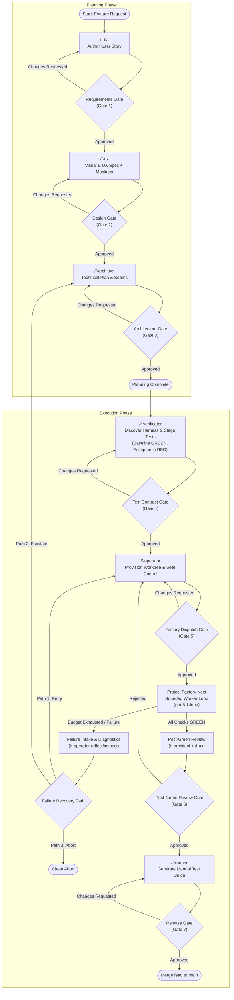
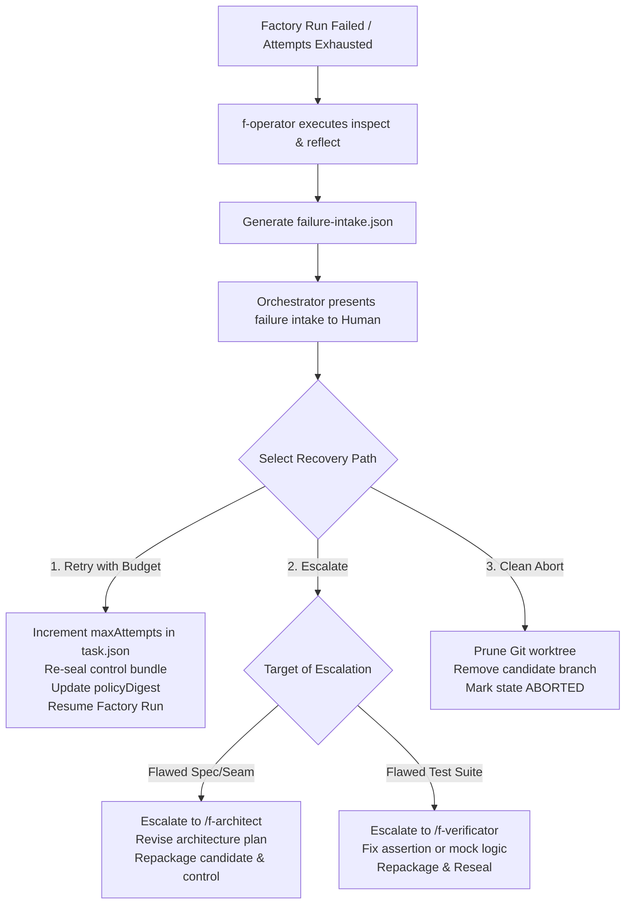

# SDLC Domain Architecture and Operational Workflow Guide

This document is the authoritative operational manual and domain architecture guide for developing software features within **Empire English CRM (EE-CRM)** using **Project Factory Next**. It defines the roles, contracts, directory topologies, state transitions, named human gates, operational commands, and failure recovery paths.

---

## 1. Architectural Principles & Isolation Model

Automated feature development with coding agents introduces distinct failure modes: agents rewriting their own tests to force green builds, scope drift across combined prompts, and polluted workspaces. The Factory SDLC solves this through three core architectural tenets:

1. **Role Specialization**: Every stage is executed by a dedicated agent role (`f-*`) tuned to a specific reasoning profile.
2. **Immutable Test Sealing**: Verification tests are authored independently by QA (`/f-verificator`) and sealed into an external control bundle before the coding worker ever starts. The worker agent has zero write access to the test suite.
3. **Tri-Directory Physical Isolation Inside the Workspace**: Project Factory Next enforces the invariant `assertSeparate(candidate, control, store)` where all three directories must be separate and non-nested. To keep all operations cleanly contained within the project repository near the target application `ee-crm/`, all three factory directories reside under `.sdlc/` (git-ignored):

```
poc-zom-report/                         ← Main Repository (Trunk & Target Project)
├── ee-crm/                             ← Active application codebase being modified
├── docs/                               ← Permanent documentation & specifications
│   ├── stories/<story-id>.md           ← Requirements & Acceptance Criteria
│   ├── architecture/                   ← Architecture Plans & ADRs
│   └── ux/                             ← Visual & UX Specifications
└── .sdlc/                              ← Ephemeral SDLC & Factory Workspaces (git-ignored)
    ├── store/                          ← 3. Factory Runs Store (execution logs, attempts, evidence)
    └── <story-id>/
        ├── candidate/                  ← 1. Candidate Worktree (isolated git worktree: feat/<story-id>)
        ├── control/                    ← 2. Sealed Control Bundle (task.json, evaluators, .seal.json)
        ├── mockups/                    ← Interactive HTML mockups (from /f-ux)
        ├── tests/                      ← Staged acceptance tests (from /f-verificator)
        ├── state.json                  ← Authoritative state ledger
        ├── review-report.md            ← Post-green review report
        └── manual-test-guide.md        ← Step-by-step manual test guide
```

### The Three Factory Folders

Project Factory Next fundamentally requires three distinct, non-nested directories:
1. **Candidate** (`.sdlc/<story-id>/candidate/`): The isolated checkout where the feature coding worker edits application code.
2. **Control** (`.sdlc/<story-id>/control/`): The sealed, immutable contract containing `task.json`, dev profile, and evaluators.
3. **Store** (`.sdlc/store/` or `.sdlc/<story-id>/store/`): The persistent evidence repository recording execution attempts, stdout/stderr streams, and telemetry.

Co-locating these three directories inside `.sdlc/` near `ee-crm/` ensures that all factory inputs and outputs stay scoped to the repository without cluttering external directories, while strictly satisfying `assertSeparate(candidate, control, store)`.

---

## 2. Shared Domain Architecture & Contracts

The authoritative definitions and canonical vocabulary for the SDLC domain are maintained in the root [**`GLOSSARY.md`**](../../GLOSSARY.md). The architectural contracts and structural roles for each element are formalized below:

### Physical Topology & Isolation
- **Candidate** (`.sdlc/<story-id>/candidate/`): An isolated Git worktree branched from `main` on `feat/<story-id>`. Contains the complete source code checkout. The coding worker modifies files solely within this boundary; the main checkout remains pristine.
- **Control** (`.sdlc/<story-id>/control/`): An external, immutable directory bundle housing `task.json`, `profile.json`, and evaluator test harnesses. The coding worker has no write permissions in this tree.
- **Store** (`.sdlc/store/`): Persistent cross-task evidence store recording telemetry, logs, and digests across all story runs for reflection and historical diagnosis.
- **Ephemeral Story Workspace** (`.sdlc/<story-id>/`): Git-ignored workspace in the main repository for pipeline state (`state.json`), intermediate acceptance tests (`tests/`), interactive mockups (`mockups/`), and review reports.

### Contracts & Cryptographic Sealing
- **Task Contract** (`control/task.json`): Schema-validated (Schema v1) specification detailing task requirements, preparation steps, evaluator check IDs, and execution budget (`maxAttempts`, `agentTimeoutMs`).
- **Dev Profile** (`control/profile.json`): Task family definition (`software-change`, `website-clone`, `design-implementation`) specifying mandatory check kinds and default budgets.
- **Policy Digest** (`policyDigest`): Lowercase 64-character SHA-256 hash computed via `node bin/factory.mjs seal --control <dir>`. Verifies control bundle immutability; rejected by runner if tampered.
- **Evaluator** (`control/evaluators/`): Sealed test scripts reporting aggregate pass/fail results via JSON (`{ status: "passed"|"failed", cases: [{ id, status, details }] }`).

---

## 3. End-to-End Operational Lifecycle & State Transitions

The SDLC progresses across two major phases: **Planning** (Requirements Gate, Design Gate, Architecture Gate) and **Execution** (Test Contract Gate, Factory Dispatch Gate, Post-Green Review Gate, Release Gate).



---

## 4. The Seven Named Human Gates Protocol

Human supervision is enforced at every role transition through named, first-class gates. Execution halts automatically and waits for explicit user sign-off.

| Gate | Name | Gate ID | Preceding Role | Primary Artifacts | Approval Criteria |
|---|---|---|---|---|---|
| **Gate 1** | **Requirements Gate** | `gate-requirements` | `/f-ba` | `docs/stories/<story-id>.md` | Scope is clear; acceptance criteria are unambiguous and testable; business invariants are stated; edge cases are identified. |
| **Gate 2** | **Design Gate** | `gate-design` | `/f-ux` | `docs/ux/<story-id>-ux.md`, `.sdlc/<story-id>/mockups/*.html` | Visual hierarchy matches brand; responsive behavior is defined; interactive HTML mockups render and behave cleanly in browser. |
| **Gate 3** | **Architecture Gate** | `gate-architecture` | `/f-architect` | `docs/architecture/<story-id>-plan.md` | Module boundaries conform to ADR-001; vertical slice seams are sound; data contracts and schema updates are complete; non-goals are explicit. |
| **Gate 4** | **Test Contract Gate** | `gate-test-contract` | `/f-verificator` | `.sdlc/<story-id>/tests/`, Verificator execution report | Baseline tests for critical journeys pass GREEN; acceptance tests for the new story staged in `.sdlc/<story-id>/tests/` demonstrably fail RED for expected reasons. |
| **Gate 5** | **Factory Dispatch Gate** | `gate-factory-dispatch` | `/f-operator` | `control/task.json`, computed `policyDigest`, profile | `policyDigest` is verified; task requirements and check IDs match; worker model (`gpt-6.1-luna`) and `maxAttempts` budget are confirmed; candidate worktree is provisioned and clean. |
| **Gate 6** | **Post-Green Review Gate** | `gate-review` | `/f-architect` + `/f-ux` | `.sdlc/<story-id>/review-report.md`, candidate git diff | Code quality matches architectural invariants; UI implementation aligns with UX tokens; no tests or evaluators were bypassed. |
| **Gate 7** | **Release Gate** | `gate-release` | `/f-runner` | `.sdlc/<story-id>/manual-test-guide.md` | Human tester successfully executed step-by-step manual test guide against live candidate; user approves merging branch to main. |

### Gate Interaction Protocol

1. **Gate Presentation**: When reaching a gate, the orchestrator halts execution and displays:
   - Current Story ID, Gate Number, and **Gate Name** (e.g., `Gate 4: Test Contract Gate`).
   - Clickable links to all generated artifacts.
   - Summary of decisions made and verification outcomes.
   - Specific questions or checkpoints requiring human validation.
2. **Acceptance (`approve [gate-name]`)**: State advances to the subsequent role in `.sdlc/<story-id>/state.json`.
3. **Revision (`revise [gate-name] --notes "<feedback>"`)**: The preceding role is re-invoked with feedback notes supplied as refinement constraints.
4. **Abort (`abort`)**: Pipeline execution terminates cleanly; transient worktrees and resources are pruned.

---

## 5. Role Specifications & Reasoning Matrix

| Role | Skill Command | Reasoning Level | Primary Responsibilities | Output Artifact |
|---|---|---|---|---|
| **Orchestrator** | `/f-orchestrator` | `medium` | Pipeline coordinator, phase state transitions, human gate enforcement, resumption management. | `.sdlc/<story-id>/state.json` |
| **Business Analyst** | `/f-ba` | `low` | Formalizing user stories, user personas, acceptance criteria, business invariants. | `docs/stories/<story-id>.md` |
| **UX Designer** | `/f-ux` | `medium` | Information hierarchy, layout rules, design tokens, responsive states, interactive HTML mockups. | `docs/ux/<story-id>-ux.md`, `.sdlc/<story-id>/mockups/` |
| **System Architect** | `/f-architect` | `high` | Technical plan, module boundaries (ADR-001), data contracts, migration plans, post-green peer review. | `docs/architecture/<story-id>-plan.md` |
| **QA Verificator** | `/f-verificator` | `high` | Harness discovery, baseline regression testing (GREEN), acceptance test authoring staged in `.sdlc/<story-id>/tests/` (RED). | Staged test suites, test verification logs |
| **Factory Operator** | `/f-operator` | `medium` | Candidate worktree setup, control bundle creation, contract sealing, factory execution, failure intake. | `.sdlc/<story-id>/`, `policyDigest` |
| **Factory Worker** | (Internal to Factory) | `medium` (`gpt-6.1-luna`) | Autonomous, bounded code implementation inside candidate worktree, guided by compiler/evaluator feedback. | Candidate git commits |
| **Quality Runner** | `/f-runner` | `medium` | End-to-end manual verification guide, startup scripts, test seed credentials, step-by-step clickthrough paths. | `.sdlc/<story-id>/manual-test-guide.md` |
| **Advisor** | `/f-advisor` | `high` | Historical run analysis from `.sdlc/store/`, bottleneck diagnosis, profile and prompt tuning. | Advisor reports, custom flow templates |

---

## 6. Operational Command Reference

### Orchestrated Workflows

```bash
# Execute Phase 1: Planning (Roles: f-ba -> Requirements Gate -> f-ux -> Design Gate -> f-architect -> Architecture Gate)
/f-orchestrator plan CRM-018

# Execute Phase 2: Execution (Roles: f-verificator -> Test Contract Gate -> f-operator -> Factory Dispatch Gate -> Factory -> Review -> Review Gate -> f-runner -> Release Gate)
/f-orchestrator execute CRM-018

# Inspect current pipeline status, active role, and pending gate
/f-orchestrator status CRM-018

# Resume an existing story from its recorded state ledger
/f-orchestrator resume CRM-018

# Terminate pipeline and clean up ephemeral worktrees
/f-orchestrator abort CRM-018
```

### Human Gate Decision Commands

When the orchestrator pauses at any of the named gates, decisions can be submitted via:

```bash
# Approve current gate (by name or default current) and advance
/f-orchestrator approve CRM-018 requirements
/f-orchestrator approve CRM-018 design
/f-orchestrator approve CRM-018 architecture
/f-orchestrator approve CRM-018 test-contract
/f-orchestrator approve CRM-018 factory-dispatch
/f-orchestrator approve CRM-018 review
/f-orchestrator approve CRM-018 release

# Request revisions from preceding role with feedback constraints
/f-orchestrator revise CRM-018 requirements --notes "Clarify conflict resolution rules in acceptance criteria"

# Abort active feature pipeline and prune ephemeral worktrees
/f-orchestrator abort CRM-018
```

> **Interactive Terminal/Chat Protocol**: When running in an interactive session, `/f-orchestrator` prompts directly after each role with artifact links and a multiple-choice prompt (`[1] Approve and proceed`, `[2] Request revisions`, `[3] Abort`). The commands above provide scriptable and explicit command-line counterparts.

### Standalone Stage Execution

Any role can be executed independently to revise or iterate on a specific deliverable:

```bash
# Business analysis only
/f-ba CRM-018

# UX design and mockups only
/f-ux CRM-018

# Architecture planning only
/f-architect CRM-018

# Test discovery and verification only
/f-verificator CRM-018

# Factory operations (provision, seal, run, inspect, recover)
/f-operator CRM-018 --action provision
/f-operator CRM-018 --action seal
/f-operator CRM-018 --action run
/f-operator CRM-018 --action inspect --run-id <run-id>
/f-operator CRM-018 --action recover --run-id <run-id>

# Manual test guide generation only
/f-runner CRM-018

# Diagnostic analysis of historical factory runs
/f-advisor analyze --store .sdlc/store
```

### Underlying Project Factory Next CLI Reference

The Factory Operator interacts directly with the Factory Next kernel. Complete flag descriptions and schemas are documented in the [Factory Next Reference Manual](../../../project-factory-next/docs/handbook/reference.md). The canonical invocations used within this SDLC are:

```bash
# 1. Initialize control bundle inside .sdlc/<story-id>/control
node /home/user/2grow/project-factory-next/bin/factory.mjs init \
  --out /home/user/2grow/poc-zom-report/.sdlc/<story-id>/control \
  --profile software-change

# 2. Validate control contracts and schema integrity
node /home/user/2grow/project-factory-next/bin/factory.mjs validate \
  --control /home/user/2grow/poc-zom-report/.sdlc/<story-id>/control

# 3. Seal the control bundle and capture policyDigest
node /home/user/2grow/project-factory-next/bin/factory.mjs seal \
  --control /home/user/2grow/poc-zom-report/.sdlc/<story-id>/control

# 4. Verify control bundle against known policyDigest
node /home/user/2grow/project-factory-next/bin/factory.mjs verify \
  --control /home/user/2grow/poc-zom-report/.sdlc/<story-id>/control \
  --policy-digest <policy-digest>

# 5. Execute factory run with candidate, control, and store co-located under .sdlc
node /home/user/2grow/project-factory-next/bin/factory.mjs run \
  --control /home/user/2grow/poc-zom-report/.sdlc/<story-id>/control \
  --candidate /home/user/2grow/poc-zom-report/.sdlc/<story-id>/candidate \
  --store /home/user/2grow/poc-zom-report/.sdlc/store \
  --policy-digest <policy-digest> \
  --agent codex \
  --model gpt-6.1-luna

# 6. Inspect evidence of a completed run
node /home/user/2grow/project-factory-next/bin/factory.mjs inspect \
  --store /home/user/2grow/poc-zom-report/.sdlc/store \
  --run-id <run-id>

# 7. Aggregate failure intake for diagnosis
node /home/user/2grow/project-factory-next/bin/factory.mjs reflect \
  --store /home/user/2grow/poc-zom-report/.sdlc/store \
  --out /home/user/2grow/poc-zom-report/.sdlc/<story-id>/failure-intake.json

# 8. Remove stale controller locks following process interruption
node /home/user/2grow/project-factory-next/bin/factory.mjs recover \
  --store /home/user/2grow/poc-zom-report/.sdlc/store \
  --run-id <run-id>
```

---

## 7. State Ledger Schema (`.sdlc/<story-id>/state.json`)

Pipeline execution state is tracked deterministically in a JSON ledger located at `.sdlc/<story-id>/state.json`.

```json
{
  "$schema": "https://json-schema.org/draft/2020-12/schema",
  "storyId": "CRM-018",
  "status": "IN_PROGRESS",
  "phase": "EXECUTION",
  "currentRole": "f-operator",
  "gateState": {
    "requirements": { "name": "Requirements Gate", "status": "APPROVED", "timestamp": "2026-10-06T10:00:00Z", "signedBy": "user" },
    "design": { "name": "Design Gate", "status": "APPROVED", "timestamp": "2026-10-06T10:15:00Z", "signedBy": "user" },
    "architecture": { "name": "Architecture Gate", "status": "APPROVED", "timestamp": "2026-10-06T10:30:00Z", "signedBy": "user" },
    "testContract": { "name": "Test Contract Gate", "status": "APPROVED", "timestamp": "2026-10-06T10:45:00Z", "signedBy": "user" },
    "factoryDispatch": { "name": "Factory Dispatch Gate", "status": "PENDING", "timestamp": null, "signedBy": null },
    "review": { "name": "Post-Green Review Gate", "status": "NOT_STARTED", "timestamp": null, "signedBy": null },
    "release": { "name": "Release Gate", "status": "NOT_STARTED", "timestamp": null, "signedBy": null }
  },
  "artifacts": {
    "storyPath": "docs/stories/CRM-018.md",
    "uxPath": "docs/ux/CRM-018-ux.md",
    "mockupsDir": ".sdlc/CRM-018/mockups/",
    "architecturePlanPath": "docs/architecture/CRM-018-plan.md",
    "testsDir": ".sdlc/CRM-018/tests/",
    "candidateDir": ".sdlc/CRM-018/candidate/",
    "controlDir": ".sdlc/CRM-018/control/",
    "storeDir": ".sdlc/store/",
    "policyDigest": "a3f4c8b...",
    "reviewReportPath": ".sdlc/CRM-018/review-report.md",
    "manualTestGuidePath": ".sdlc/CRM-018/manual-test-guide.md"
  },
  "factory": {
    "runId": "run-crm-018-001",
    "attemptCount": 0,
    "maxAttempts": 3,
    "lastExitCode": null,
    "lastOutcome": null
  },
  "history": [
    { "phase": "PLANNING", "role": "f-ba", "status": "COMPLETED", "timestamp": "2026-10-06T10:00:00Z" }
  ]
}
```

### Lifecycle Status Matrix

```text
INITIALIZED ──> PLANNING_BA ──> REQUIREMENTS_GATE ──> PLANNING_UX ──> DESIGN_GATE
                                                                           │
┌──────────────────────────────────────────────────────────────────────────┘
▼
PLANNING_ARCHITECT ──> ARCHITECTURE_GATE ──> PLANNED ──> EXEC_VERIFICATOR
                                                                │
┌───────────────────────────────────────────────────────────────┘
▼
TEST_CONTRACT_GATE ──> EXEC_OPERATOR ──> FACTORY_DISPATCH_GATE ──> FACTORY_RUNNING
                                                                          │
┌─────────────────────────────────────────────────────────────────────────┘
▼
REVIEW_PENDING ──> REVIEW_GATE ──> MANUAL_RUNNER ──> RELEASE_GATE ──> COMPLETED
                                                           │
                              ┌────────────────────────────┴───────────┐
                              ▼                                        ▼
                            FAILED                                  ABORTED
```

---

## 8. Failure Handling & Recovery Paths

When Project Factory Next encounters failed checks or exhausts its attempt budget (`maxAttempts`), the operator enters a controlled failure intake workflow.



### Path 1: Retry with Increased Attempt Budget

Used when the worker is making demonstrable progress and only requires 1–2 additional attempts to resolve remaining check failures.
1. The operator updates `budget.maxAttempts` in `.sdlc/<story-id>/control/task.json` (e.g., from 3 to 5).
2. The operator reseals the control directory:
   ```bash
   node /home/user/2grow/project-factory-next/bin/factory.mjs seal \
     --control /home/user/2grow/poc-zom-report/.sdlc/<story-id>/control
   ```
3. The new `policyDigest` is updated in `.sdlc/<story-id>/state.json`.
4. The factory run is resumed with the new digest and a new run ID.

### Path 2: Escalation to Architect or Verificator

Used when the failure stems from a defect in the specification, an architectural mismatch, or an invalid/flaky acceptance assertion.
- **Escalate to `/f-architect`**: If the candidate failed because architectural module seams were infeasible or API contracts were incompatible. `/f-architect` updates `docs/architecture/<story-id>-plan.md`, and `/f-operator` refreshes the task context before resealing.
- **Escalate to `/f-verificator`**: If an acceptance test contains an erroneous expectation, bad seed data, or harness timing issues. `/f-verificator` updates the test directly inside `.sdlc/<story-id>/control/evaluators/` (or staged in `.sdlc/<story-id>/tests/`) without touching the candidate worktree. `/f-operator` then re-validates and re-seals the control bundle with `factory.mjs seal`.

### Path 3: Clean Abort

Used when the feature is rejected or abandoned.
1. Candidate Git worktree is safely pruned:
   ```bash
   git worktree remove --force /home/user/2grow/poc-zom-report/.sdlc/<story-id>/candidate/
   git branch -D feat/<story-id>
   ```
2. Ephemeral control and story directories are archived or deleted.
3. State in `.sdlc/<story-id>/state.json` is marked `ABORTED`.
4. Main repository checkouts and `ee-crm/` remain completely untouched.

### Operational Infrastructure Recovery: Dead-Worker Lock Removal

Separate from the three feature failure paths above, if a running controller process is abruptly terminated by OS interrupt, power loss, or container termination, the run directory retains an active lock PID.
1. Confirm the background worker process is dead.
2. Recover the run lock:
   ```bash
   node /home/user/2grow/project-factory-next/bin/factory.mjs recover \
     --store /home/user/2grow/poc-zom-report/.sdlc/store \
     --run-id <original-run-id>
   ```
3. Re-invoke the original run command with identical parameters and run ID. Execution resumes at the next attempt if budget remains.

---

## 9. Governing Invariants & Guardrails

1. **Feature Scope Exclusivity**: Project Factory Next is reserved strictly for **feature development**. Bug fixes and exploratory research spikes bypass the factory and use direct developer flows.
2. **Evaluator Immutability**: Acceptance evaluators live exclusively in `.sdlc/<story-id>/control/evaluators/`. Any candidate commits modifying test assertions are strictly rejected during post-green review.
3. **No Automated Main Merges**: The pipeline never performs automated merges into `main`. The candidate branch `feat/<story-id>` is merged only upon explicit human sign-off at the **Release Gate**.
4. **Clean Worktree Isolation**: All feature development occurs inside `.sdlc/<story-id>/candidate/`. Direct modifications to `ee-crm/` in the main workspace during execution are forbidden.
5. **Agnostic Test Harnessing**: Verificator test suites inspect and invoke the application's native scripts (such as `npm test` or native Node scripts in `ee-crm`), ensuring the pipeline does not impose artificial test frameworks.
