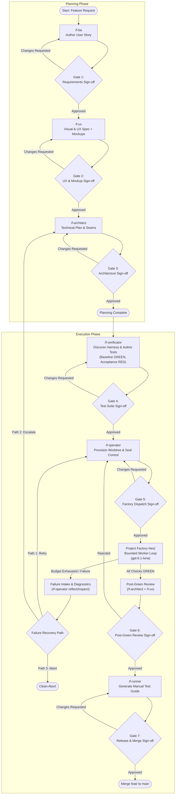
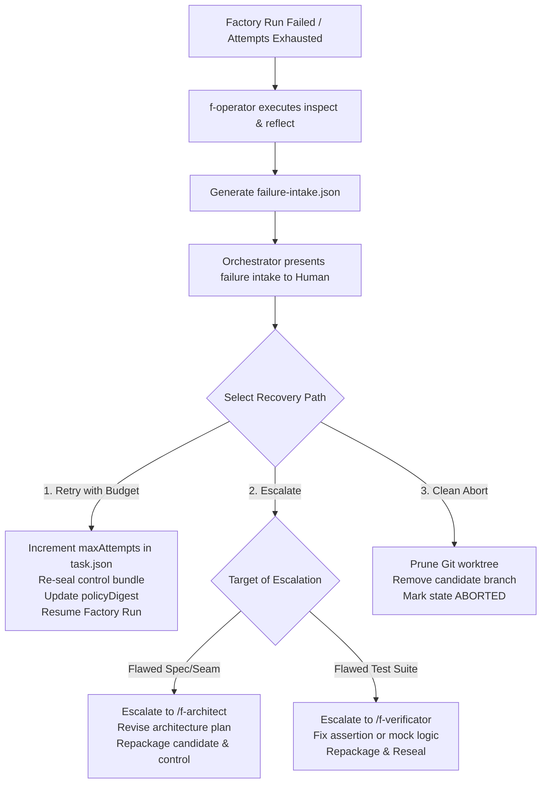

# SDLC Domain Architecture and Operational Workflow Guide

This document is the authoritative operational manual and domain architecture guide for developing software features within **Empire English CRM (EE-CRM)** using **Project Factory Next**. It defines the roles, contracts, directory topologies, state transitions, human gates, operational commands, and failure recovery paths.

---

## 1. Architectural Principles & Isolation Model

Automated feature development with coding agents introduces distinct failure modes: agents rewriting their own tests to force green builds, scope drift across combined prompts, and polluted workspaces. The Factory SDLC solves this through three core architectural tenets:

1. **Role Specialization**: Every stage is executed by a dedicated agent role (`f-*`) tuned to a specific reasoning profile.
2. **Immutable Test Sealing**: Verification tests are authored independently by QA (`/f-verificator`) and sealed into an external control bundle before the coding worker ever starts. The worker agent has zero write access to the test suite.
3. **Tri-Directory Physical Isolation**: To satisfy the invariant `assertSeparate(candidate, control, store)`, code modification, test evaluation, and run history operate in completely disjoint directory trees.

```
/home/user/2grow/
├── poc-zom-report/                  ← Main Repository (Trunk & Permanent Specs)
│   ├── docs/stories/<story-id>.md   ← Requirements & Acceptance Criteria
│   ├── docs/architecture/          ← Architecture Plans & ADRs
│   ├── docs/ux/                     ← Visual & UX Specifications
│   └── .sdlc/<story-id>/            ← Ephemeral Pipeline State & UI Mockups (git-ignored)
│       └── state.json               ← Authoritative State Ledger
├── factory-workspaces/<story-id>/
│   ├── candidate/                   ← Isolated Git Worktree (branch: feat/<story-id>)
│   └── control/                     ← Sealed Control Bundle (task.json, evaluators, .seal.json)
└── factory-runs/                    ← Persistent Runs Store (shared execution history)
```

---

## 2. Shared Domain Vocabulary

The following terms form the canonical domain language of the Factory SDLC. All operational tooling, logs, and agent prompts strictly adhere to these definitions.

### Workspace & Topology

- **Candidate**: An isolated Git worktree (`factory-workspaces/<story-id>/candidate/`) on branch `feat/<story-id>`. It contains the complete source code checkout where the factory coding worker makes edits. The main repository checkout remains untouched.
  - _Avoid_: Working copy, staging branch, agent sandbox, target directory.
- **Control**: An immutable, sealed directory bundle (`factory-workspaces/<story-id>/control/`) housing `task.json`, `profile.json`, and evaluator scripts. The coding worker has no write permissions in this tree.
  - _Avoid_: Test runner folder, benchmark config, validation harness, guard bundle.
- **Factory Runs Store (`factory-runs`)**: A persistent directory (`/home/user/2grow/factory-runs/`) storing run summaries, attempt telemetry, stdout/stderr streams, and execution evidence across all feature tasks.
  - _Avoid_: Log archive, output directory, run cache, history store.
- **Ephemeral SDLC Workspace (`.sdlc/<story-id>/`)**: A git-ignored workspace within the main repository storing active pipeline state (`state.json`), intermediate HTML mockups, and post-green review reports.
  - _Avoid_: Temp dir, scratch folder, build output, agent workdir.

### Contracts & Sealing

- **Task Contract (`task.json`)**: The schema-validated (Schema v1) contract inside `control/` specifying feature title, intent, requirements, optional preparation build steps, evaluation checks, and attempt budgets (`maxAttempts`, `agentTimeoutMs`).
  - _Avoid_: Job spec, run configuration, ticket json, prompt file.
- **Dev Profile**: A reusable profile configuration (`profile.json` in control) defining the task family (e.g., `software-change`, `website-clone`, `design-implementation`), required check kinds, and default attempt limits.
  - _Avoid_: Pipeline template, project type, environment config, check preset.
- **Policy Digest (`policyDigest`)**: A lowercase 64-character SHA-256 hash generated by `node bin/factory.mjs seal --control <dir>`. It cryptographically represents the exact contents of the control bundle. The runner rejects any execution whose control content deviates from the supplied policy digest.
  - _Avoid_: Checksum, version hash, seal token, signature.
- **Evaluator**: An executable script inside `control/evaluators/` invoked by Factory Next. It evaluates candidate behavior and prints a single JSON result to stdout complying with the schema `{ status: "passed"|"failed", cases: [{ id, status, details }] }`.
  - _Avoid_: Test case, assert script, checker, verifier agent.

### Governance & Execution

- **Human Gate**: An explicit, mandatory pause in the orchestration lifecycle requiring human inspection and approval before advancing to the subsequent role or execution phase.
  - _Avoid_: Checkpoint, confirmation step, approval barrier, sync point.
- **Factory Worker**: A bounded coding agent (default model: `gpt-6.1-luna`) dispatched by Project Factory Next inside the candidate worktree under strict deadlines and tool constraints.
  - _Avoid_: Coder bot, dev agent, builder, prompt loop.
- **State Ledger (`state.json`)**: The machine-readable state tracking file located at `.sdlc/<story-id>/state.json` recording current lifecycle phase, active role, gate approvals, attempt counts, and artifact locations.
  - _Avoid_: Progress tracker, status cache, pipeline db.
- **Failure Intake**: A diagnostic JSON document generated via `node bin/factory.mjs reflect --store <dir>` aggregating error patterns, failed checks, and evidence across attempts.
  - _Avoid_: Error log, crash dump, incident report, autopsy.

---

## 3. End-to-End Operational Lifecycle & State Transitions

The SDLC progresses across two major phases: **Planning** (Gates 1–3) and **Execution** (Gates 4–7).



---

## 4. The Seven Human Gates Protocol

Human supervision is enforced at every role transition. Execution halts automatically and waits for explicit user sign-off.

| Gate | Name | Preceding Role | Primary Artifacts | Approval Criteria |
|---|---|---|---|---|
| **Gate 1** | Requirements Sign-off | `/f-ba` | `docs/stories/<story-id>.md` | Scope is clear; acceptance criteria are unambiguous and testable; business invariants are stated; edge cases are identified. |
| **Gate 2** | UX & Mockup Sign-off | `/f-ux` | `docs/ux/<story-id>-ux.md`, `.sdlc/<story-id>/mockups/*.html` | Visual hierarchy matches brand; responsive behavior is defined; interactive HTML mockups render and behave cleanly in browser. |
| **Gate 3** | Architecture Sign-off | `/f-architect` | `docs/architecture/<story-id>-plan.md` | Module boundaries conform to ADR-001; vertical slice seams are sound; data contracts and schema updates are complete; non-goals are explicit. |
| **Gate 4** | Test Suite Sign-off | `/f-verificator` | Candidate tests, Verificator execution report | Baseline tests for critical journeys pass GREEN; acceptance tests for the new story demonstrably fail RED for the expected reasons. |
| **Gate 5** | Factory Dispatch Sign-off | `/f-operator` | `control/task.json`, computed `policyDigest`, profile | `policyDigest` is verified; task requirements and check IDs match; worker model (`gpt-6.1-luna`) and `maxAttempts` budget are confirmed. |
| **Gate 6** | Post-Green Review Sign-off | `/f-architect` + `/f-ux` | `.sdlc/<story-id>/review-report.md`, candidate git diff | Code quality matches architectural invariants; UI implementation aligns with UX tokens; no tests or evaluators were bypassed. |
| **Gate 7** | Release & Merge Sign-off | `/f-runner` | `.sdlc/<story-id>/manual-test-guide.md` | Human tester successfully executed step-by-step manual test guide against live candidate; user approves merging branch to main. |

### Gate Interaction Protocol

1. **Gate Presentation**: When reaching a gate, the active role or orchestrator displays:
   - Current Story ID and Gate Number.
   - Clickable links to all generated artifacts.
   - Summary of decisions made and verification outcomes.
   - Specific questions or checkpoints requiring validation.
2. **Acceptance (`approve`)**: State advances to the subsequent role in `.sdlc/<story-id>/state.json`.
3. **Revision (`revise <notes>`)**: The preceding role is re-invoked with the human notes supplied as refinement constraints.
4. **Abort (`abort`)**: Pipeline execution terminates cleanly; transient resources are pruned.

---

## 5. Role Specifications & Reasoning Matrix

| Role | Skill Command | Reasoning Level | Primary Responsibilities | Output Artifact |
|---|---|---|---|---|
| **Orchestrator** | `/f-orchestrator` | `medium` | Pipeline coordinator, phase state transitions, human gate enforcement, resumption management. | `.sdlc/<story-id>/state.json` |
| **Business Analyst** | `/f-ba` | `low` | Formalizing user stories, user personas, acceptance criteria, business invariants. | `docs/stories/<story-id>.md` |
| **UX Designer** | `/f-ux` | `medium` | Information hierarchy, layout rules, design tokens, responsive states, interactive HTML mockups. | `docs/ux/<story-id>-ux.md`, `.sdlc/<story-id>/mockups/` |
| **System Architect** | `/f-architect` | `high` | Technical plan, module boundaries (ADR-001), data contracts, migration plans, post-green peer review. | `docs/architecture/<story-id>-plan.md` |
| **QA Verificator** | `/f-verificator` | `high` | Harness discovery, baseline regression testing (GREEN), acceptance test authoring (RED). | Candidate test files, test verification logs |
| **Factory Operator** | `/f-operator` | `medium` | Candidate worktree setup, control bundle creation, contract sealing, factory execution, failure intake. | `factory-workspaces/<story-id>/`, `policyDigest` |
| **Factory Worker** | (Internal to Factory) | `medium` (`gpt-6.1-luna`) | Autonomous, bounded code implementation inside candidate worktree, guided by compiler/evaluator feedback. | Candidate git commits |
| **Quality Runner** | `/f-runner` | `medium` | End-to-end manual verification guide, startup scripts, test seed credentials, step-by-step clickthrough paths. | `.sdlc/<story-id>/manual-test-guide.md` |
| **Advisor** | `/f-advisor` | `high` | Historical run analysis from `factory-runs/`, bottleneck diagnosis, profile and prompt tuning. | Advisor reports, custom flow templates |

---

## 6. Operational Command Reference

### Orchestrated Workflows

```bash
# Execute Phase 1: Planning (Roles: f-ba -> Gate 1 -> f-ux -> Gate 2 -> f-architect -> Gate 3)
/f-orchestrator plan CRM-018

# Execute Phase 2: Execution (Roles: f-verificator -> Gate 4 -> f-operator -> Gate 5 -> Factory -> Review -> Gate 6 -> f-runner -> Gate 7)
/f-orchestrator execute CRM-018

# Inspect current pipeline status and active gate
/f-orchestrator status CRM-018

# Resume an existing story from its recorded state ledger
/f-orchestrator resume CRM-018

# Terminate pipeline and clean up ephemeral worktrees
/f-orchestrator abort CRM-018
```

### Standalone Stage Execution

Any role can be executed independently to revise or iterate on a specific deliverable:

```bash
# Business analysis only
/f-ba CRM-018

# UX design and mockups only
/f-ux CRM-018

# Architecture planning only
/f-architect CRM-018

# Test discovery and verification only
/f-verificator CRM-018

# Factory operations (provision, seal, run, inspect, recover)
/f-operator CRM-018 --action provision
/f-operator CRM-018 --action seal
/f-operator CRM-018 --action run
/f-operator CRM-018 --action inspect --run-id <run-id>
/f-operator CRM-018 --action recover --run-id <run-id>

# Manual test guide generation only
/f-runner CRM-018

# Diagnostic analysis of historical factory runs
/f-advisor analyze --store /home/user/2grow/factory-runs
```

### Underlying Project Factory Next CLI Reference

The Factory Operator interacts directly with the Factory Next kernel via Node:

```bash
# 1. Initialize control bundle
node /home/user/2grow/project-factory-next/bin/factory.mjs init \
  --out /home/user/2grow/factory-workspaces/<story-id>/control \
  --profile software-change

# 2. Validate control contracts and schema integrity
node /home/user/2grow/project-factory-next/bin/factory.mjs validate \
  --control /home/user/2grow/factory-workspaces/<story-id>/control

# 3. Seal the control bundle and capture policyDigest
node /home/user/2grow/project-factory-next/bin/factory.mjs seal \
  --control /home/user/2grow/factory-workspaces/<story-id>/control

# 4. Verify control bundle against known policyDigest
node /home/user/2grow/project-factory-next/bin/factory.mjs verify \
  --control /home/user/2grow/factory-workspaces/<story-id>/control \
  --policy-digest <policy-digest>

# 5. Execute factory run
node /home/user/2grow/project-factory-next/bin/factory.mjs run \
  --control /home/user/2grow/factory-workspaces/<story-id>/control \
  --candidate /home/user/2grow/factory-workspaces/<story-id>/candidate \
  --store /home/user/2grow/factory-runs \
  --policy-digest <policy-digest> \
  --agent codex \
  --model gpt-6.1-luna

# 6. Inspect evidence of a completed run
node /home/user/2grow/project-factory-next/bin/factory.mjs inspect \
  --store /home/user/2grow/factory-runs \
  --run-id <run-id>

# 7. Aggregate failure intake for diagnosis
node /home/user/2grow/project-factory-next/bin/factory.mjs reflect \
  --store /home/user/2grow/factory-runs \
  --out /home/user/2grow/poc-zom-report/.sdlc/<story-id>/failure-intake.json

# 8. Remove stale controller locks following process interruption
node /home/user/2grow/project-factory-next/bin/factory.mjs recover \
  --store /home/user/2grow/factory-runs \
  --run-id <run-id>
```

---

## 7. State Ledger Schema (`.sdlc/<story-id>/state.json`)

Pipeline execution state is tracked deterministically in a JSON ledger located at `.sdlc/<story-id>/state.json`.

```json
{
  "$schema": "https://json-schema.org/draft/2020-12/schema",
  "storyId": "CRM-018",
  "status": "IN_PROGRESS",
  "phase": "EXECUTION",
  "currentRole": "f-operator",
  "gateState": {
    "gate1": { "status": "APPROVED", "timestamp": "2026-10-06T10:00:00Z", "signedBy": "user" },
    "gate2": { "status": "APPROVED", "timestamp": "2026-10-06T10:15:00Z", "signedBy": "user" },
    "gate3": { "status": "APPROVED", "timestamp": "2026-10-06T10:30:00Z", "signedBy": "user" },
    "gate4": { "status": "APPROVED", "timestamp": "2026-10-06T10:45:00Z", "signedBy": "user" },
    "gate5": { "status": "PENDING", "timestamp": null, "signedBy": null },
    "gate6": { "status": "NOT_STARTED", "timestamp": null, "signedBy": null },
    "gate7": { "status": "NOT_STARTED", "timestamp": null, "signedBy": null }
  },
  "artifacts": {
    "storyPath": "docs/stories/CRM-018.md",
    "uxPath": "docs/ux/CRM-018-ux.md",
    "mockupsDir": ".sdlc/CRM-018/mockups/",
    "architecturePlanPath": "docs/architecture/CRM-018-plan.md",
    "candidateDir": "/home/user/2grow/factory-workspaces/CRM-018/candidate/",
    "controlDir": "/home/user/2grow/factory-workspaces/CRM-018/control/",
    "policyDigest": "a3f4c8b...",
    "reviewReportPath": ".sdlc/CRM-018/review-report.md",
    "manualTestGuidePath": ".sdlc/CRM-018/manual-test-guide.md"
  },
  "factory": {
    "runId": "run-crm-018-001",
    "attemptCount": 0,
    "maxAttempts": 3,
    "lastExitCode": null,
    "lastOutcome": null
  },
  "history": [
    { "phase": "PLANNING", "role": "f-ba", "status": "COMPLETED", "timestamp": "2026-10-06T10:00:00Z" }
  ]
}
```

### Lifecycle Status Matrix

```
INITIALIZED ──> PLANNING_BA ──> GATE_1_PENDING ──> PLANNING_UX ──> GATE_2_PENDING
      │
      └──> PLANNING_ARCHITECT ──> GATE_3_PENDING ──> PLANNED
                                                        │
┌───────────────────────────────────────────────────────┘
▼
EXEC_VERIFICATOR ──> GATE_4_PENDING ──> EXEC_OPERATOR ──> GATE_5_PENDING
      │
      └──> FACTORY_RUNNING ──> REVIEW_PENDING ──> GATE_6_PENDING
                                                        │
┌───────────────────────────────────────────────────────┘
▼
MANUAL_RUNNER ──> GATE_7_PENDING ──> COMPLETED
      │
      ├──> FAILED (Budget exhausted / Unrecoverable)
      └──> ABORTED (Clean teardown requested)
```

---

## 8. Failure Handling & Recovery Paths

When Project Factory Next encounters failed checks or exhausts its attempt budget (`maxAttempts`), the operator enters a controlled failure intake workflow.



### Path 1: Retry with Increased Attempt Budget

Used when the worker is making demonstrable progress and only requires 1–2 additional attempts to resolve remaining check failures.
1. The operator updates `budget.maxAttempts` in `control/task.json` (e.g., from 3 to 5).
2. The operator reseals the control directory:
   ```bash
   node /home/user/2grow/project-factory-next/bin/factory.mjs seal \
     --control /home/user/2grow/factory-workspaces/<story-id>/control
   ```
3. The new `policyDigest` is updated in `.sdlc/<story-id>/state.json`.
4. The factory run is resumed with the new digest and a new run ID.

### Path 2: Escalation to Architect or Verificator

Used when the failure stems from a defect in the specification, an architectural mismatch, or an invalid/flaky acceptance assertion.
- **Escalate to `/f-architect`**: If the candidate failed because architectural module seams were infeasible or API contracts were incompatible. `/f-architect` updates `docs/architecture/<story-id>-plan.md`.
- **Escalate to `/f-verificator`**: If an acceptance test contains an erroneous expectation, bad test seed data, or race conditions. `/f-verificator` fixes the test in the candidate, and `/f-operator` copies it into `control/evaluators/` and reseals.

### Path 3: Clean Abort

Used when the feature is rejected or abandoned.
1. Candidate Git worktree is safely pruned:
   ```bash
   git worktree remove --force /home/user/2grow/factory-workspaces/<story-id>/candidate/
   git branch -D feat/<story-id>
   ```
2. Ephemeral control directory is archived or deleted.
3. State in `.sdlc/<story-id>/state.json` is marked `ABORTED`.
4. Main repository remains completely untouched.

### Path 4: Process Interruption & Dead-Worker Lock Recovery

If a running controller process is abruptly terminated (e.g., power loss, container kill, timeout interrupt), the run directory retains an active lock PID.
1. Confirm the background worker process is dead.
2. Recover the run lock:
   ```bash
   node /home/user/2grow/project-factory-next/bin/factory.mjs recover \
     --store /home/user/2grow/factory-runs \
     --run-id <original-run-id>
   ```
3. Re-invoke the run command with identical parameters and run ID. Execution resumes at the next attempt if budget remains.

---

## 9. Governing Invariants & Guardrails

1. **Feature Scope Exclusivity**: Project Factory Next is reserved strictly for **feature development**. Bug fixes and exploratory research spikes bypass the factory and use direct developer flows.
2. **Evaluator Immutability**: Acceptance evaluators live exclusively in `control/evaluators/`. Any candidate commits modifying test assertions are strictly rejected during post-green review.
3. **No Automated Main Merges**: The pipeline never performs automated merges into `main`. The candidate branch `feat/<story-id>` is merged only upon explicit human sign-off at **Gate 7**.
4. **Clean Worktree Isolation**: All feature development must occur in `/home/user/2grow/factory-workspaces/<story-id>/candidate/`. Direct modifications to the root working directory during execution are forbidden.
5. **Agnostic Test Harnessing**: Verificator test suites inspect and invoke the application's native scripts (such as `npm test` or native Node scripts in `ee-crm`), ensuring the pipeline does not impose artificial test frameworks.
